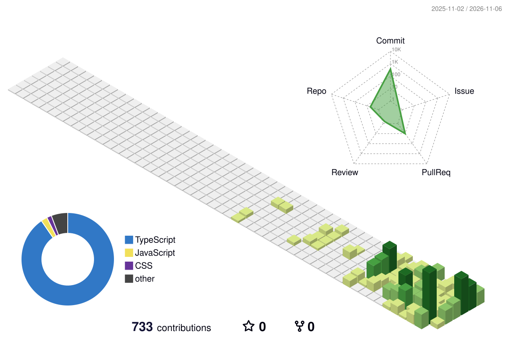

<!-- GitHub profile README for gmldbs25/gmldbs25 -->

# Heeyoon

**Backend Engineer · AI Agents · Creative Development**

Java/Spring 기반 백엔드 개발을 중심으로 일하고 있습니다.  
AI Agent, 시뮬레이션, 인터랙티브 콘텐츠에도 관심이 많고, 떠오른 아이디어를 실제로 동작하는 소프트웨어로 만드는 것을 즐깁니다.

**생각하고, 만들고, 기록합니다.**

  

[**Build Canvas — 개발 기록 보러 가기**](https://gmldbs25.github.io/build-canvas/)

---

## Featured Projects

<table>
  <tr>
    <td width="50%" valign="top">
      <!-- 아래 이미지 경로는 실제 배포 화면 캡처를 추가하면 활성화됩니다. -->
      <!--  -->
      <h3><a href="https://kotomachi-yoon.vercel.app/">KotoMachi</a></h3>
      
삿포로의 일상을 여행하며 일본어를 배우는 스토리형 2D RPG. 대화, 탐색, 학습을 하나의 작은 세계에 담았습니다.

      
React · TypeScript · Canvas · PWA

      
<a href="https://kotomachi-yoon.vercel.app/"><b>Play Game</b></a>

    </td>
    <td width="50%" valign="top">
      <!--  -->
      <h3><a href="https://fabflow-yoon.vercel.app/">FAB FLOW</a></h3>
      
OHT와 FOUP의 물류 흐름을 관찰하고 직접 운영하는 반도체 FAB 시뮬레이터. 다양한 조건을 바꾸며 물류 시스템을 실험합니다.

      
Next.js · TypeScript · Three.js · Simulation

      
<a href="https://fabflow-yoon.vercel.app/"><b>Launch Simulation</b></a>

    </td>
  </tr>
</table>

## Build Canvas

**생각 · 개발 · 기록**  
인터랙티브 콘텐츠와 개인 프로젝트의 제작 과정, 기술적 고민을 정리하는 공간입니다.

[**Explore Build Canvas**](https://gmldbs25.github.io/build-canvas/) · [**Source Code**](https://github.com/gmldbs25/build-canvas)

## Tech & Interests

**Main**  
`Java` · `Spring Boot` · `Python` · `TypeScript`

**Building with**  
`React` · `Next.js` · `Three.js` · `FastAPI`

**Interested in**  
`AI Agents` · `Reinforcement Learning` · `Simulation` · `Creative Coding`
