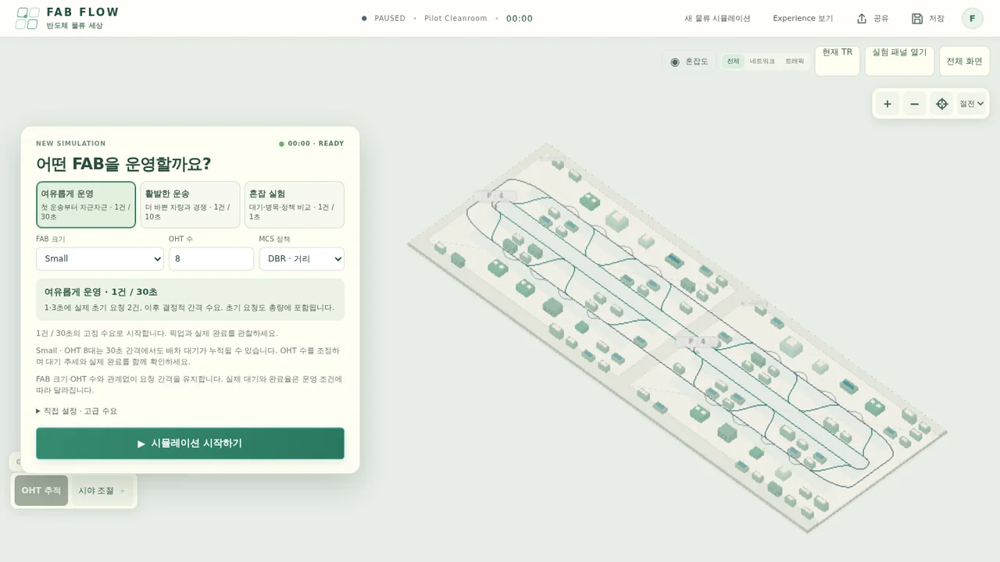

<!-- GitHub profile README for gmldbs25/gmldbs25 -->

# Heeyoon

**Backend Engineer · AI Agents · Creative Development**

Java/Spring 기반 백엔드 개발을 중심으로 일하고 있습니다.  
AI Agent, 시뮬레이션, 인터랙티브 콘텐츠에도 관심이 많고, 떠오른 아이디어를 실제로 동작하는 소프트웨어로 만드는 것을 즐깁니다.

---

## Featured Projects

### Build Canvas

**Interactive Portfolio · Development Stories**

개인 프로젝트의 결과물과 제작 과정을 모아둔 포트폴리오입니다. AI, 게임, 시뮬레이션을 비롯한 작업들을 인터랙티브 콘텐츠와 개발 기록으로 소개합니다.

[**Explore Build Canvas**](https://gmldbs25.github.io/build-canvas/) · [**Source Code**](https://github.com/gmldbs25/build-canvas)

### Live Projects

<table>
  <tr>
    <td width="50%" valign="top">
      
      <h3><a href="https://kotomachi-yoon.vercel.app/">KotoMachi</a></h3>
      
삿포로의 일상을 여행하며 일본어를 배우는 스토리형 2D RPG. 대화, 탐색, 학습을 하나의 작은 세계에 담았습니다.

      
React · TypeScript · Canvas · PWA

      
<a href="https://kotomachi-yoon.vercel.app/"><b>Play Game</b></a>

    </td>
    <td width="50%" valign="top">
      
      <h3><a href="https://fabflow-yoon.vercel.app/">FAB FLOW</a></h3>
      
OHT와 FOUP의 물류 흐름을 관찰하고 직접 운영하는 반도체 FAB 시뮬레이터. 다양한 조건을 바꾸며 물류 시스템을 실험합니다.

      
Next.js · TypeScript · Three.js · Simulation

      
<a href="https://fabflow-yoon.vercel.app/"><b>Launch Simulation</b></a>

    </td>
  </tr>
</table>

## Contribution Activity

  

## Tech & Interests

**Main**  
`Java` · `Spring Boot` · `Python` · `TypeScript`

**Building with**  
`React` · `Next.js` · `Three.js` · `FastAPI`

**Interested in**  
`AI Agents` · `Reinforcement Learning` · `Simulation` · `Creative Coding`
